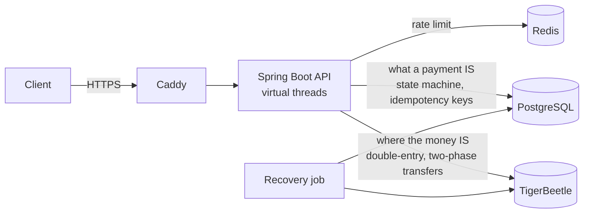

# PayCore

**A payment-processing backend that never loses or double-charges money, even when it crashes mid-payment.**

Java 21 · Spring Boot 4 · TigerBeetle · PostgreSQL · Redis · Kafka · React · Docker

> **Live demo:** `https://<your-domain>/` · API docs at `/swagger-ui/index.html`

---

## What it does

Customers pay merchants from a wallet; PayCore keeps a 2% platform fee. Payments work like card payments:
**authorize** (hold the money) → **capture** (move it) or **cancel** (release it) → optionally **refund**.

```
POST /accounts                     create a customer wallet or merchant
POST /accounts/{id}/top-ups        add money                       (Idempotency-Key)
POST /payments                     pay; capture now or later        (Idempotency-Key)
POST /payments/{id}/capture | cancel | refund
GET  /payments/{id}, /accounts/{id}
```

## Try it in the browser

| Page | What you can do |
|---|---|
| **Playground** | One-click sandbox (wallet with ₹5,000 + merchant), then pay, hold, capture, release and refund, with live ledger balances |
| **Break-it Lab** | Fire real concurrent attacks at the API: a retry storm (5 identical requests → 1 charge), a race to overspend (20 payments vs a wallet that affords 5), hold-and-release, and idempotency-key misuse |
| **Ledger Explorer** | Every TigerBeetle transfer for any account as a T-account, plus a live check that total debits = total credits across the whole ledger |
| **How it works** | Pick where the server crashes during a payment and see what each database holds and how PayCore recovers |

The UI is React (JSX) + Tailwind + Motion, built into the Spring Boot jar so the site and API share one origin.

## Architecture



**Two databases, two jobs.** PostgreSQL stores what a payment *is* (who, how much, which state).
TigerBeetle, a database built only for financial accounting, stores where the money *is*:
every movement is a balanced double-entry transfer, and overdrafts are rejected by the database itself.

## Hard problems solved

| Problem | Solution | Proven by |
|---|---|---|
| **Double charges on retry.** A client times out and resends the payment. | `Idempotency-Key` header with a unique constraint in Postgres; every ledger transfer id is **derived from the payment id**, so a retried step re-sends the same ids and TigerBeetle answers `exists`. | `retryWithSameIdempotencyKeyReturnsSamePaymentAndChargesOnce`, `retryingEveryStepNeverMovesMoneyTwice` |
| **Dual writes.** Postgres and the ledger can't be updated atomically; a crash in between leaves them disagreeing. | Every step records its intent first (`CAPTURING`), then moves money, then records the outcome. A **recovery job** finishes anything stuck in an `-ING` state, which is safe because of the deterministic ids. | `recoveryFinishesAPaymentInterruptedAfterTheLedgerWrite`, plus a manual test: ledger killed mid-payment → API returns 503 → payment completes automatically when the ledger returns, charged exactly once |
| **Race conditions.** Two payments spend the same balance at the same moment. | Balance rule (`debits_must_not_exceed_credits`) enforced **inside the ledger**, not in Java; optimistic locking (`@Version`) on payment rows. | `concurrentPaymentsNeverOverdrawTheWallet`: 50 concurrent payments against a wallet that affords 10 → exactly 10 succeed |
| **Partial payments.** The merchant gets paid but the platform fee fails. | Merchant leg and fee leg are submitted as **linked transfers**: both succeed or neither does. | `authorizeHoldsMoneyAndCaptureMovesIt` |
| **Invalid transitions.** Capturing a cancelled payment. | Explicit state machine in Postgres, plus the ledger rejects posting a voided hold. | `cancelledPaymentCannotBeCaptured` |
| **Floating-point money.** | All amounts are integers in the smallest unit (paise); fees use basis points. | `FeePolicy` |

## Design decisions

- **Fail closed for money, fail open for rate limiting.** If the ledger is unreachable, PayCore refuses to move money (503) and the recovery job finishes later. If Redis is down, rate limiting is skipped: it protects capacity, not money.
- **Why TigerBeetle plus Postgres, not Postgres alone?** Double-entry invariants, overdraft protection, two-phase transfers and idempotent ids are built into TigerBeetle, so correctness doesn't depend on every code path remembering a check.
- **Why not MongoDB?** Payments need all-or-nothing multi-row changes and database-enforced constraints (`fee < amount`, unique idempotency keys).
- **Authorization holds expire** after 7 days in the ledger itself, just like card authorizations.

## Run locally

Needs Java 21, PostgreSQL 16 (db/user/password `paycore`), Redis, and a single-replica TigerBeetle 0.17.9 on port 3000:

```bash
./tigerbeetle format --cluster=0 --replica=0 --replica-count=1 --development ./0_0.tigerbeetle
./tigerbeetle start --addresses=3000 --development ./0_0.tigerbeetle
./mvnw spring-boot:run          # API on http://localhost:8080
cd web && npm install && npm run dev   # UI on http://localhost:5173 (proxies API calls to :8080)
```

Tests run against real local services (a `paycore_test` database and the local TigerBeetle):

```bash
./mvnw test
```

## Deploy

One VM, one command: see [deploy/DEPLOY.md](deploy/DEPLOY.md) (Docker Compose with Caddy for automatic HTTPS; runs on Oracle Cloud's free ARM VM).

## Roadmap

- Transactional outbox → Kafka for payment events and merchant webhooks
- Reconciliation job checking the zero-sum invariant and Postgres ↔ ledger agreement
- Load test and batching of ledger writes
